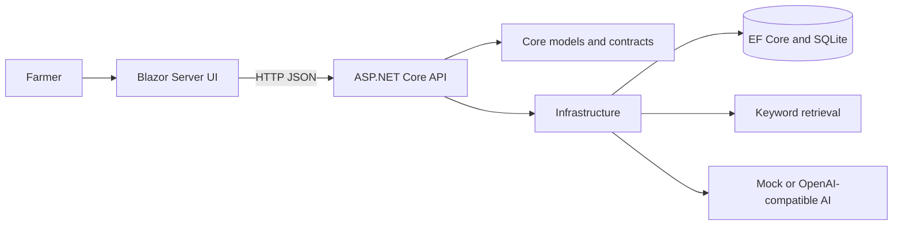

# KrishiMitra

KrishiMitra is an educational, single-user demo farming companion for arecanut farmers in Karnataka. It provides a farm profile, activity and expense log, in-app reminders, a small curated knowledge collection, and a chat interface backed by a mock assistant by default.

The app uses synthetic demo data. It is not production-secure, does not authenticate users, and must not be used to store sensitive or real farmer data. AI responses are general information, not agricultural advice.

## Features

- Mobile-friendly Kannada-first Blazor dashboard with links to each workflow.
- Farm profile create, read, update and delete.
- Activity create, edit, filter, date-range expense totals and delete.
- Reminder create, edit, status filters, completion and delete.
- Chat history stored in SQLite and a “new conversation” action.
- Keyword search over educational demo knowledge documents.
- Predictable mock AI works without an API key; optional OpenAI-compatible chat completions provider.
- Swagger API documentation in Development.

## Screenshots

Dashboard screenshot placeholder: add an updated capture here after running both local processes.

## Architecture



The Web app and API run as two local processes. The API owns validation, AI orchestration, retrieval and database access; the Web app calls its HTTP endpoints. See [architecture](docs/architecture.md) and [AI notes](docs/ai-explanation.md).

## Requirements

- .NET 8 SDK or newer SDK with .NET 8 targeting support.
- A browser.

## Run locally

Open two terminals at the repository root.

Terminal 1 — API and SQLite:

```powershell
dotnet run --project src/KrishiMitra.Api --launch-profile http
```

The API applies EF Core migrations at startup and creates `App_Data/krishimitra.db` in the solution root. It does not drop or recreate an existing database. Swagger is at `http://localhost:5255/swagger` in Development.

Terminal 2 — Blazor UI:

```powershell
dotnet run --project KrishiMitra.Web --launch-profile http
```

Open the URL printed by `dotnet run` (the default launch profile uses `http://localhost:5216`). The Web app expects the API at `http://localhost:5255/`; override `ApiBaseUrl` in `KrishiMitra.Web/appsettings.Development.json` if needed.

## AI configuration

The default `AI:Provider` is `Mock`, so no network call or key is required. The mock response is labeled in the chat UI.

For an OpenAI-compatible chat completions endpoint, set these environment variables for the API process:

```powershell
$env:AI__Provider = "OpenAICompatible"
$env:AI__BaseUrl = "https://your-provider.example/v1"
$env:AI__Model = "your-model-name"
$env:AI__ApiKey = "your-secret-key"
dotnet run --project src/KrishiMitra.Api --no-launch-profile --urls http://localhost:5255
```

The API holds the key server-side. Do not commit it or place it in Web settings. Provider responses are bounded by a timeout and malformed or failed responses receive a safe fallback. No automated test calls a live model.

## Build and tests

```powershell
dotnet build KrishiMitra.sln
dotnet test tests/KrishiMitra.Core.Tests
```

Tests cover farm validation, deterministic mock behavior, knowledge ranking/no-match behavior, and reminder completion persistence. API workflows can also be inspected through Swagger while the API is running.

## Project structure

```text
KrishiMitra.Web/                 Blazor UI and API client
src/KrishiMitra.Api/             REST controllers, DI and startup
src/KrishiMitra.Core/            Farm models, DTOs and contracts
src/KrishiMitra.Infrastructure/  EF Core, SQLite, migrations, AI and retrieval
tests/KrishiMitra.Core.Tests/     xUnit tests
docs/                            Architecture and AI explanations
```

## Limitations and next steps

- Single-user demo profile; no identity, authorization, tenant boundaries or production data protections.
- Knowledge content is generic demo education with no claimed official source. Review it with qualified local specialists before any real-world use.
- Mock AI is intentionally predictable. A configured LLM can be wrong; it does not provide live weather, prices, government data, disease diagnosis, or input dosage recommendations.
- Interface labels are currently Kannada-first; chat accepts Kannada or English, but a full translated English UI is not yet implemented.
- Two-process local development is used for clear API/Web separation. A production deployment needs secure hosting, authentication, backups, monitoring, migrations and a reviewed agronomic knowledge base.
- Add future schema changes as EF Core migrations; never drop the local database as a startup shortcut.

## Interview walkthrough

Start with the problem and user, then trace a request from a Blazor page through `FarmApiClient`, an API controller, `FarmDbContext`, and SQLite. For chat, describe the separate `IKnowledgeRetriever` and `IAiAssistant` contracts: deterministic offline mock by default, optional server-side OpenAI-compatible HTTP integration, and retrieved text treated as untrusted context. The main trade-off is deliberately simple keyword retrieval and a single-user demo instead of production identity or semantic search.
